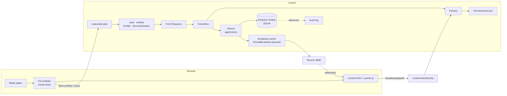

# Architecture

FakeDiscord is a server-rendered Laravel 12 app. Blade renders every page, and
small dependency-free ES modules in `resources/js` handle the live parts. A
Laravel Reverb websocket server pushes changes to the browser. There is no SPA
framework and no build step beyond Vite and Tailwind.

## Layers

| Layer | Where | What it does |
| --- | --- | --- |
| Routes | `routes/web.php`, `routes/channels.php` | HTTP routes in the `web` group (CSRF, sessions), most of them in an `['auth', 'verified']` group; websocket channel rules |
| Form Requests | `app/Http/Requests` | Validation and the authorisation check for writes (for example `StoreMessageRequest` checks `ChannelPolicy::sendMessages` and the attachment rules) |
| Controllers | `app/Http/Controllers` | Thin: authorise, call one action, return a view, a redirect or JSON. Most endpoints answer both a form post and `fetch()`, so the pages also work without JavaScript |
| Actions | `app/Actions/{Account,Channels,Conversations,Friends,Messages,Moderation,Profile,Roles,Servers}` | One class per use case (`SendMessage`, `BanMember`, `AcceptInvite`, …). They own the transactions, row locks and broadcasts |
| Policies | `app/Policies` | Laravel Policies for servers, channels, roles, messages, invites, DMs and friendships. The ones that depend on server permissions never read the bits themselves; they ask `PermissionService` |
| Permission engine | `app/Services/PermissionService.php`, `app/Enums/Permission.php` | Discord's permission model: role bitmasks, Administrator, the role hierarchy, channel overrides and timeouts |
| Support | `app/Support` | Shared logic that is not a use case: `Markdown`, `Mentions`, `MessageFeed`, `MessageSearch`, `UnreadState`, `MemberList`, `ServerPresence`, `RateLimits`, `AuditLog`, … |
| Observers | `app/Observers` | Write the [audit log](features.md#audit-log) when models change |
| Frontend | `resources/js`, `resources/views` | One ES module per feature (`channel-messages.js`, `typing-indicator.js`, `presence.js`, …), started by `resources/js/app.js` |

## Permissions

`PermissionService` is the only place that turns role bits into decisions. The
resolution follows Discord:

1. Not a member: nothing. The owner: everything.
2. Otherwise OR the `@everyone` role with every role the member holds.
   Administrator turns into every flag.
3. In a channel: apply the `@everyone` override, hide private channels, then
   apply all role overrides together (denies first, then allows, so an allow
   on one role beats a deny on another).
4. A timed-out member keeps only View Channels.

On top of that, the **role hierarchy** decides who can manage, kick, ban or
time out whom: only roles and members below your own highest role, whatever
flags you have. Details and the full flag table are in
[features.md](features.md#permissions).

## Realtime

Broadcasts are queued (`ShouldBroadcast`, on the `database` queue): the request only
adds a job and one queue worker sends it to Reverb, so run one (`composer dev` does;
see [hosting.md](hosting.md)). A failed job is reported in `failed_jobs` and not
retried, but the change is still saved. The sender's own socket
is skipped (`X-Socket-ID`) because the HTTP response already carries the
result.

| Channel | Type | Who may join | Events |
| --- | --- | --- | --- |
| `channel.{id}` | private | members who can see the channel | `.message.sent`, `.message.updated`, `.message.deleted`, `.reactions.updated`, `.message.pinned` |
| `conversation.{id}` | private | DM participants | the same message events for DMs |
| `typing.{id}` | presence | members who can see the channel | `client-typing` whispers |
| `conversation-typing.{id}` | presence | DM participants | `client-typing` whispers |
| `server.{id}` | presence | server members | joining and leaving (online presence), `.user.status` |
| `App.Models.User.{id}` | private | that user | `.friendship.changed`, `.member.moderated`, `.dm.received`, `.conversation.activity`, `.conversation.updated`, `.user.status`, mention notifications |
| `test` | public | anyone | `.test.message` (smoke test only, no user data) |

Some details that matter:

- **Typing indicators** never touch Laravel. They are client whispers on a
  presence channel, and the sender is taken from the `user_id` Reverb adds,
  never from the payload.
- **Presence** counts a user once across tabs, and has a 10-second grace period
  so a page load does not make people blink offline.
- **Kicks and bans** also call Reverb's `terminate_connections` API
  (`App\Support\RealtimeSessions`). pusher-js then reconnects and every channel
  is authorised again, which a former member fails.
- `tests/Feature/Security/BroadcastChannelAuthorisationTest.php` pins this list
  and who may join each channel.

## Data

SQLite with foreign keys on. `ON DELETE` rules do the cleanup: deleting a
server removes its channels, messages, roles and invites. Messages are
soft-deleted, so replies keep their reference, and the messages of a deleted
account stay, shown as "Deleted User". The full schema, ERD, indexes and
delete rules are in [database-schema.md](database-schema.md).

Concurrency is handled in the database, not in PHP:

- Invite uses are counted with one guarded `UPDATE … WHERE uses < max_uses`.
- Friend request changes only match rows still in the expected state.
- Reactions and 1:1 DMs rely on unique indexes plus `createOrFirst()`.
- Group DM seats are counted with the conversation row locked.

## Search

[Laravel Scout](https://laravel.com/docs/scout) with the `database` driver: a
`LIKE` query on `messages.content`, limited to the server's channels the user
can see. It needs no index to build or external service to run. If it gets too
slow, the next step would be an SQLite FTS5 table.
