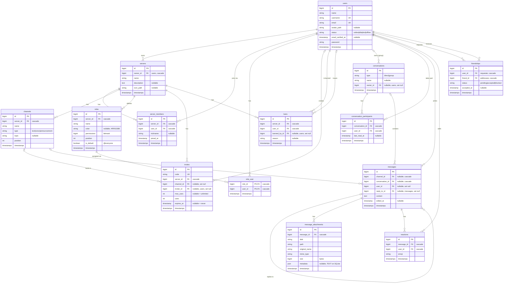

# Database schema

FakeDiscord runs on **SQLite**. Migrations live in `database/migrations`. To rebuild
the database from scratch, run:

```bash
php artisan migrate:fresh        # add --seed for the test user
```

## ERD

GitHub and most Markdown viewers render the Mermaid diagram below. Laravel's
framework tables (`password_reset_tokens`, `sessions`, `cache`, `jobs`, …) are
left out.



## Indexes

| Table | Index | Used for |
|-------|-------|----------|
| `messages` | `(channel_id, created_at)` | Paging through a channel's history |
| `messages` | `(conversation_id, created_at)` | Paging through a DM's history |
| `messages` | `user_id`, `reply_to_id` | FK lookups and `ON DELETE` actions |
| `channels` | `(server_id, position)` | Sidebar order |
| `roles` | `(server_id, position)` | Role hierarchy |
| `server_members` | unique `(server_id, user_id)`, `user_id` | Member list / "my servers" |
| `role_user` | PK `(role_id, user_id)`, `user_id` | A user's roles |
| `conversation_participants` | unique `(conversation_id, user_id)`, `user_id` | DM list |
| `reactions` | unique `(message_id, emoji, user_id)`, `user_id` | Reaction counts; one reaction per emoji per user |
| `friendships` | unique `(user_id, friend_id)`, `(friend_id, status)` | Outgoing and incoming requests |
| `invites` | unique `code`, `server_id` | Invite lookup by code |
| `bans` | unique `(server_id, user_id)`, `user_id` | Ban checks on join |

SQLite does not index foreign key columns automatically, so every FK column
used for lookups or `ON DELETE` actions has its own index, or is the first
column of a composite one.

## Delete behaviour

- **Deleting a server** also deletes its channels, roles, members, invites, bans
  and, through channels, its messages with their attachments and reactions.
- **Deleting a user** deletes their memberships, role assignments, reactions,
  friendships, DM participation and owned servers. Their **messages stay**, with
  `user_id` set to NULL (shown as "Deleted User"). Invites they created and bans
  they issued also stay, with the user column set to NULL.
- **Deleting a message** sets `reply_to_id` on replies to NULL. The replies
  themselves stay.

## Invariants enforced in the app layer

A CHECK constraint or partial index would need raw SQL that only works on one
database, so these rules live in the app layer (validation, model events or policies):

- A message has **exactly one** of `channel_id` or `conversation_id`.
- `role_user`: the user must be a member of the role's server. Each server has
  exactly one `is_default` role.
- `friendships`: the reverse pair (B→A when A→B already exists) is not allowed.
  `user_id <> friend_id`.
- `conversations.type = 'direct'` has exactly two participants.
- Values in the `status` and `type` columns. These are plain strings, not
  `enum()`, because Laravel turns `enum()` into a CHECK constraint on SQLite,
  and changing it later would mean rebuilding the whole table.

## SQLite notes

- `DB_FOREIGN_KEYS=true` (the default in `config/database.php`, and set in
  `.env.example`) turns on `PRAGMA foreign_keys`. Without it SQLite ignores
  every FK and `ON DELETE` rule.
- `roles.permissions` is an integer bitmask. SQLite integers are signed
  64-bit, so permission flags must stay within bits 0–62.
- `json` columns are stored as `TEXT`. Use Eloquent's `array`/`json` casts.
- Write future migrations with SQLite's limited `ALTER TABLE` in mind. Adding
  nullable or defaulted columns and creating or dropping indexes is cheap. Changing or
  dropping columns makes Laravel rebuild the table, so avoid it on large tables.
