# Database schema

FakeDiscord runs on **SQLite**. Migrations live in `database/migrations`. To rebuild
the database from scratch, run:

```bash
php artisan migrate:fresh        # add --seed for the demo data (DemoSeeder)
```

## ERD

GitHub and most Markdown viewers render the Mermaid diagram below. Laravel's
framework tables (`password_reset_tokens`, `sessions`, `cache`, `jobs`, …) are
left out.

```mermaid
erDiagram
    users {
        bigint id PK
        string name
        string username UK
        string email UK
        string avatar_path "nullable"
        string bio "nullable, max 190"
        string status "online|idle|dnd|offline"
        string theme "dark|light, default dark"
        timestamp email_verified_at "nullable"
        string password
        timestamps timestamps
    }

    servers {
        bigint id PK
        bigint owner_id FK "users, cascade"
        string name
        text description "nullable"
        string icon_path "nullable"
        timestamps timestamps
    }

    server_members {
        bigint id PK
        bigint server_id FK "cascade"
        bigint user_id FK "cascade"
        string nickname "nullable"
        timestamp joined_at
        timestamp timed_out_until "nullable"
        timestamps timestamps
    }

    channel_categories {
        bigint id PK
        bigint server_id FK "cascade"
        string name
        int position
        timestamps timestamps
    }

    channels {
        bigint id PK
        bigint server_id FK "cascade"
        bigint category_id FK "nullable, channel_categories, set null"
        string name
        string type "text|voice|announcement"
        string topic "nullable"
        int position
        boolean is_private "default false"
        timestamps timestamps
    }

    channel_permission_overrides {
        bigint id PK
        bigint channel_id FK "cascade"
        bigint role_id FK "cascade"
        bigint allow "Permission bitmask"
        bigint deny "Permission bitmask"
        timestamps timestamps
    }

    notifications {
        uuid id PK
        string type "App\Notifications\MentionedInMessage"
        string notifiable_type "morph: users"
        bigint notifiable_id "morph, no FK"
        text data "JSON snapshot"
        timestamp read_at "nullable, NULL = unread"
        timestamps timestamps
    }

    channel_reads {
        bigint id PK
        bigint user_id FK "cascade"
        bigint channel_id FK "cascade"
        bigint last_read_message_id "default 0, no FK: high-water mark"
        timestamps timestamps
    }

    notification_mutes {
        bigint id PK
        bigint user_id FK "cascade"
        bigint server_id FK "cascade"
        bigint channel_id FK "nullable, cascade; NULL = whole server"
        timestamps timestamps
    }

    roles {
        bigint id PK
        bigint server_id FK "cascade"
        string name
        string color "nullable, #RRGGBB"
        bigint permissions "bitmask"
        int position
        boolean is_default "@everyone"
        timestamps timestamps
    }

    role_user {
        bigint role_id PK,FK "cascade"
        bigint user_id PK,FK "cascade"
        timestamps timestamps
    }

    conversations {
        bigint id PK
        string type "direct|group"
        string name "nullable"
        bigint owner_id FK "nullable, users, set null"
        string direct_key "nullable, unique, lower:higher user id"
        timestamp last_message_at "nullable"
        timestamps timestamps
    }

    conversation_participants {
        bigint id PK
        bigint conversation_id FK "cascade"
        bigint user_id FK "cascade"
        timestamp last_read_at "nullable"
        timestamps timestamps
    }

    messages {
        bigint id PK
        bigint channel_id FK "nullable, cascade"
        bigint conversation_id FK "nullable, cascade"
        bigint user_id FK "nullable, set null"
        bigint reply_to_id FK "nullable, messages, set null"
        text content
        timestamp edited_at "nullable"
        timestamp deleted_at "nullable, soft delete"
        timestamp pinned_at "nullable, NULL = not pinned"
        bigint pinned_by_id FK "nullable, users, set null"
        json mentions "nullable, {users, roles, everyone}"
        timestamps timestamps
    }

    message_attachments {
        bigint id PK
        bigint message_id FK "cascade"
        string disk
        string path
        string original_name
        string mime_type
        bigint size "bytes"
        json metadata "nullable, TEXT on SQLite"
        timestamps timestamps
    }

    reactions {
        bigint id PK
        bigint message_id FK "cascade"
        bigint user_id FK "cascade"
        string emoji
        timestamps timestamps
    }

    friendships {
        bigint id PK
        bigint user_id FK "requester, cascade"
        bigint friend_id FK "addressee, cascade"
        string status "pending|accepted|blocked"
        timestamp accepted_at "nullable"
        timestamps timestamps
    }

    invites {
        bigint id PK
        string code UK
        bigint server_id FK "cascade"
        bigint channel_id FK "nullable, set null"
        bigint inviter_id FK "nullable, users, set null"
        int max_uses "nullable = unlimited"
        int uses
        timestamp expires_at "nullable = never"
        timestamps timestamps
    }

    bans {
        bigint id PK
        bigint server_id FK "cascade"
        bigint user_id FK "cascade"
        bigint banned_by_id FK "nullable, users, set null"
        string reason "nullable"
        timestamps timestamps
    }

    audit_log_entries {
        bigint id PK
        bigint server_id FK "cascade"
        bigint actor_id FK "nullable, users, set null"
        string action "e.g. member.ban, role.update"
        string target_type "nullable: user|channel|role|..."
        bigint target_id "nullable, no FK: outlives the target"
        string target_label "nullable, name at the time"
        json details "nullable, field => old/new"
        string reason "nullable"
        timestamp created_at
    }

    users ||--o{ servers : owns
    users ||--o{ server_members : "joins via"
    servers ||--o{ server_members : has
    servers ||--o{ channels : has
    servers ||--o{ channel_categories : has
    channel_categories |o--o{ channels : groups
    servers ||--o{ roles : defines
    roles ||--o{ role_user : "assigned via"
    users ||--o{ role_user : has
    users ||--o{ channel_reads : "reads up to"
    channels ||--o{ channel_reads : "read by"
    users ||--o{ notification_mutes : mutes
    servers ||--o{ notification_mutes : "muted by"
    channels |o--o{ notification_mutes : "muted by"
    channels ||--o{ channel_permission_overrides : "overrides in"
    roles ||--o{ channel_permission_overrides : "overridden by"
    servers ||--o{ invites : has
    channels |o--o{ invites : "lands in"
    users |o--o{ invites : creates
    servers ||--o{ bans : has
    users ||--o{ bans : "is banned"
    users |o--o{ bans : issues
    servers ||--o{ audit_log_entries : logs
    users |o--o{ audit_log_entries : "acts in"

    users |o--o{ conversations : "owns (group)"
    conversations ||--o{ conversation_participants : has
    users ||--o{ conversation_participants : "takes part"

    channels |o--o{ messages : contains
    conversations |o--o{ messages : contains
    users |o--o{ messages : writes
    messages |o--o{ messages : "replies to"
    users |o--o{ messages : pins
    messages ||--o{ message_attachments : has
    messages ||--o{ reactions : has
    users ||--o{ reactions : adds

    users ||--o{ friendships : requests
    users ||--o{ friendships : receives
```



## Indexes

| Table | Index | Used for |
|-------|-------|----------|
| `messages` | `(channel_id, created_at)` | Paging through a channel's history |
| `messages` | `(conversation_id, created_at)` | Paging through a DM's history |
| `messages` | `(channel_id, pinned_at)` | A channel's pinned messages, newest pin first |
| `messages` | `user_id`, `reply_to_id`, `pinned_by_id` | FK lookups and `ON DELETE` actions |
| `channels` | `(server_id, position)` | Sidebar order |
| `channels` | `category_id` | A category's channels; `ON DELETE SET NULL` |
| `channel_categories` | `(server_id, position)` | Sidebar order of categories |
| `roles` | `(server_id, position)` | Role hierarchy |
| `server_members` | unique `(server_id, user_id)`, `user_id` | Member list / "my servers" |
| `role_user` | PK `(role_id, user_id)`, `user_id` | A user's roles |
| `channel_permission_overrides` | unique `(channel_id, role_id)`, `role_id` | A channel's role overrides; `ON DELETE` of a role |
| `conversation_participants` | unique `(conversation_id, user_id)`, `user_id` | DM list |
| `conversations` | unique `direct_key`, `last_message_at` | One 1:1 DM per pair of users; DM list by latest activity |
| `reactions` | unique `(message_id, emoji, user_id)`, `user_id` | Reaction counts; one reaction per emoji per user |
| `friendships` | unique `(user_id, friend_id)`, `(friend_id, status)` | Outgoing and incoming requests |
| `invites` | unique `code`, `server_id` | Invite lookup by code |
| `bans` | unique `(server_id, user_id)`, `user_id` | Ban checks on join |
| `audit_log_entries` | `(server_id, action)`, `(actor_id, server_id)` | The audit log page and its action / user filters |
| `channel_reads` | unique `(user_id, channel_id)`, `channel_id` | Unread dots and mention badges (one marker per user per channel); `ON DELETE` of a channel |
| `notification_mutes` | unique `(user_id, server_id, channel_id)`, `server_id`, `channel_id` | Mute settings: who muted a channel or its server (one query per message); `ON DELETE` of a server or channel |

SQLite does not index foreign key columns automatically, so every FK column
used for lookups or `ON DELETE` actions has its own index, or is the first
column of a composite one.

## Delete behaviour

Attachment rows (`message_attachments`) go with their message through the
cascade, but the files on disk do not: `ChannelController::destroy` and
`ServerController::destroy` read the paths first and delete the files after
the commit (`MessageAttachment::filesInChannels()` / `deleteFiles()`). Soft
deleting a message keeps its files (the row stays), but they can no longer be
downloaded.

- **Deleting a server** also deletes its channels, channel categories, roles,
  members, invites, bans, audit log and, through channels, its messages with
  their attachments and reactions.
- **Deleting a channel or a role** deletes its `channel_permission_overrides`.
  Deleting a channel also deletes its `channel_reads`; so does deleting a
  user. Leaving a server keeps them, so a rejoin carries on where it left off.
- **Mute settings** (`notification_mutes`) go with the user, the server or the
  channel. Leaving a server (or being kicked or banned) deletes your mutes for
  it, so a rejoin starts unmuted.
- **Deleting a channel category** keeps its channels: `category_id` is set to
  NULL (the app also moves them to the bottom of the uncategorised list).
- **Deleting a user** deletes their memberships, role assignments, reactions,
  friendships, DM participation and owned servers. Their **messages stay**, with
  `user_id` set to NULL (shown as "Deleted User"). Invites they created, bans
  they issued and audit log entries of what they did also stay, with the user
  column set to NULL. Messages they pinned
  stay pinned, with `pinned_by_id` set to NULL.
- **Deleting a message** sets `reply_to_id` on replies to NULL. The replies
  themselves stay.

## Invariants enforced in the app layer

A CHECK constraint or partial index would need raw SQL that only works on one
database, so these rules live in the app layer (validation, model events or policies):

- A message has **exactly one** of `channel_id` or `conversation_id`.
- `channels.category_id` points at a category of the **same** server.
  `channels.position` and `channel_categories.position` order items within their
  group (a category, or the uncategorised channels).
- `role_user`: the user must be a member of the role's server. Each server has
  exactly one `is_default` role.
- `channel_permission_overrides`: the role belongs to the channel's server, and
  a row allows or denies at least one flag (all inherit deletes it).
- `friendships`: the reverse pair (B→A when A→B already exists) is not allowed.
  `user_id <> friend_id`.
- `conversations.type = 'direct'` has exactly two participants, and its
  `direct_key` is `"{lower user id}:{higher user id}"` of those two (NULL for
  group DMs). `last_message_at` is the newest message's time.
- `conversations.type = 'group'` has at most 10 participants
  (`Conversation::MAX_PARTICIPANTS`, checked with the row locked in
  `ManageGroupConversation`). Its `owner_id` is one of them. When the owner
  leaves, ownership passes to the longest-standing participant, and a group
  whose last participant leaves is deleted.
- `messages.mentions` is who a server channel message mentions,
  worked out by `App\Support\Mentions::resolve()` whenever its content is
  saved: `{"users": [ids], "roles": [ids], "everyone": bool}`, or NULL for
  nobody and for DMs. Users are members of the server; `everyone` is only
  true when the author had Mention @everyone in the channel. Unread mention
  badges and mention notifications read it, so renames and permission
  changes do not change who an old message mentioned. Messages from before
  the column have NULL: they mention nobody.
- `notifications` is Laravel's database notifications table (only
  `App\Notifications\MentionedInMessage` for now). `notifiable` is a
  polymorphic pair with no foreign key. The app removes a message's
  notifications when it is deleted and a server's when someone leaves it;
  the inbox drops (and deletes) the ones that no longer lead anywhere
  (`App\Support\NotificationInbox`). `data` holds `message_id`,
  `channel_id`, `server_id`, `reason` (`user`|`role`|`everyone`),
  `role_name`, `author`, `server_name`, `channel_name` and `excerpt`.
- `users.status` is the status a user picked: `online`, `idle` or `dnd`
  (`User::ONLINE_STATUSES`). Whether they are connected comes from
  the server's Reverb presence channel, not from this column. The database
  default is still `offline`, from before presence. New users get `online`
  from the model, and a stored `offline` reads as `online` once connected.
- `users.theme` is the colour theme a user picked: `dark` (the default) or
  `light` (`User::THEMES`). The layouts put it on
  `<html data-theme>`; an unknown value reads as `dark`
  (`User::preferredTheme()`).
- Values in the `status` and `type` columns. These are plain strings, not
  `enum()`, because Laravel turns `enum()` into a CHECK constraint on SQLite,
  and changing it later would mean rebuilding the whole table.

## SQLite notes

- `DB_FOREIGN_KEYS=true` (the default in `config/database.php`, and set in
  `.env.example`) turns on `PRAGMA foreign_keys`. Without it SQLite ignores
  every FK and `ON DELETE` rule.
- `roles.permissions` is an integer bitmask. SQLite integers are signed
  64-bit, so permission flags must stay within bits 0–62.
- `json` columns are stored as `TEXT`. Use Eloquent's `array`/`json` casts.
- Write future migrations with SQLite's limited `ALTER TABLE` in mind. Adding
  nullable or defaulted columns and creating or dropping indexes is cheap. Changing or
  dropping columns makes Laravel rebuild the table, so avoid it on large tables.
